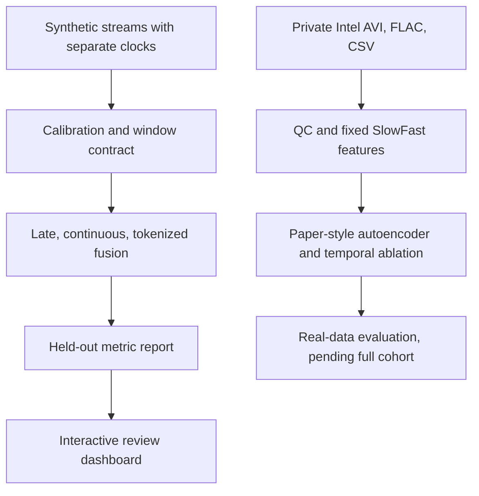

# WeldOps multimodal research portfolio

## What this demonstrates

A reproducible **synthetic** benchmark for combining signals with distinct
sample rates and device clocks. It connects three capabilities in this repo:

1. **Data engineering:** individual clock domains, independent calibration
   landmarks, source provenance, interval aggregation and session-disjoint
   train/validation/test partitions.
2. **Model comparison:** single-stream models, validation-selected late audio–video
   fusion, continuous joint features, four-bin learned token boundaries and
   an uncalibrated-clock ablation. These lightweight classifiers are supervised
   *only on generated data*. The separate Intel paper replication and temporal
   transformer in `video_experiment.py` are not represented by these metrics.
3. **Evaluation and review:** test ROC AUC, precision/recall at a documented
   0.5 threshold, per-category slices, episode timelines, and local EmbeddingGemma
   2 nearest-neighbor review. No model output is wired to a PLC or physical robot.

The public artifact contains no Intel recordings or private-derived embeddings.
The benchmark's full 96-episode report is generated deterministically from seed
42. `web/demo-multimodal-report.json` is an example output; regenerate it with
the CLI and compare outputs before using it in a presentation.

| Portfolio capability | Evidence in this repository |
| --- | --- |
| Multimodal ingestion and time series | Independent video, audio and sensor clocks with validated calibration landmarks and interval features |
| Model development | Unimodal baselines, validation-selected late fusion, continuous interactions and discretized ablation |
| Reproducible evaluation | Session-disjoint partitions, defect slices, deterministic seed and inspectable window scores |
| Model review and visualization | Local dashboard with defect filtering, episode timelines and a separate embedding explorer |
| Robotics and edge integration | Virtual-cell demonstration exists separately; no measured deployment or hardware control claim |

## Run the portfolio demo

From the repository root with NumPy installed:

```bash
PYTHONPATH=src python -m weldfusion.multimodal_benchmark /tmp/weldops-report.json --seed 42
python -m http.server 8765 --directory web
```

Open `http://localhost:8765/fusion.html`. The page loads the committed synthetic
report and also accepts a locally generated report JSON through the file picker.
Choose a defect slice, test episode and comparison model to inspect scores and
the ground-truth fault interval. For the separate EmbeddingGemma review UI,
open `http://localhost:8765/embeddings.html` and select **Explore synthetic
demo**. Its fabricated vectors demonstrate navigation only; real embedding
generation requires authorized local AVI/FLAC inputs and weights. The existing
virtual-cell simulator is at `/index.html`.

## Data and clock contract

The generator makes 20-second episodes with file-relative timebases:

| Stream | Rate | Numerical channels | Simulated clock |
| --- | ---: | --- | --- |
| Video proxy | 5 Hz | normalized arc brightness | independent offset and rate |
| Audio proxy | 25 Hz | normalized acoustic energy | independent offset and rate |
| Sensor proxy | 10 Hz | normalized current, shielding-gas flow | independent offset and rate |

Each source time is `t_device = offset + rate * t_reference`. Three independent
calibration landmarks estimate an affine map and a **fourth, withheld** landmark
checks its residual (reject above 120 ms). These landmarks are generated by the
simulation; real clock alignment requires identifiable physical landmarks and
an uncertainty audit. All interval features preserve modality presence flags.
One-second bins are constructed after calibration. The uncalibrated ablation
uses raw device time for the same binning. This deliberately tests the impact
of timing error. It does not establish an actual hardware synchronization result.

The synthetic faults are visible in selected proxies: Overlap changes brightness
and audio energy, gas loss changes sensor flow and audio, and spatter changes
audio and video. This is a teaching construction, **not a physics-accurate
welding simulator** or a claim that these are sufficient real-world signals.
Four categories are balanced per synthetic session. The first eight sessions
train, the next two select the late-fusion weight, and the last two are untouched
until evaluation. Windows from a session never cross partitions.

## Models and metrics

Logistic classifiers with L2 regularization fit on one-second labeled synthetic
windows. Train-only mean and standard deviation normalize continuous features.
Train-only quartile boundaries convert numerical channels to four one-hot bins
for the tokenized variant; presence flags remain continuous. This is a simple
tabular discretization **rather than an LLM tokenizer or transformer**. The
continuous variant adds pairwise cross-modal products so a linear classifier
can model limited interactions. Video, audio and sensor baselines use their own
channels. Late fusion combines independent video/audio probabilities, selecting
its weight on validation AUC in 0.05 steps. This synthetic task is supervised;
Intel's anomaly models train on Good examples only.

Metrics in the page are **window-level**, not weld-level. Per-category slices
include Good windows and every window in the chosen defective welds; only
intervals intersecting the injected fault carry a positive window label.
ROC AUC is threshold-independent. Precision and recall are shown at 0.5 as a
transparent demonstration, not a calibrated industrial decision threshold.
There is no measured edge latency, energy, power, throughput, VLA, RL policy,
world-model prediction, or physical closed loop. Those job-description skills
would require separate evidence; the portfolio should not imply they exist.

On the fixed seed the synthetic test AUCs are 0.797 video, 0.946 audio, 0.946
late fusion, 0.955 continuous, 0.916 tokenized and 0.930 uncalibrated continuous.
These numbers illustrate a controlled ablation **for the generator as written**;
they are not an estimate of real weld performance. Report seed variation before
claiming even a synthetic generalization advantage.

## Relationship to the rest of the repo



The synthetic and private-data paths share lessons about provenance,
partitioning and calibration, but never share reported metrics. For the real
paper comparison see `PAPER_REPRO_LOCAL.md` and
`TEMPORAL_OVERLAP_AND_EMBEDDING_EXPERIMENT.md`. Raw private media remains in
authorized GCS locations; the dashboard does not fetch it. The local embedding
index, if created from real clips, contains private-derived vectors and must
not be committed.

## Next experiments

1. Validate the paper-style video baseline and masked temporal model on a
   complete, audited SlowFast cohort. Predefine the Overlap-vs-Good test and
   report per-session uncertainty and overall defect performance.
2. Compare EmbeddingGemma 2 retrieval with SlowFast retrieval using reviewed
   short fault segments and session-disjoint candidate pools.
3. Fit clock maps to real independent landmarks, document uncertainty and
   missing streams, then compare early fusion against same-cohort late fusion.
4. Only after measured inference profiling, evaluate export to ONNX or an edge
   runtime. Quantization claims require measured accuracy and device latency.

## Verify

```bash
PYTHONPATH=src python -m pytest -q tests/test_multimodal_benchmark.py
node --test web/fusion-core.test.mjs web/embedding-core.test.mjs
```
